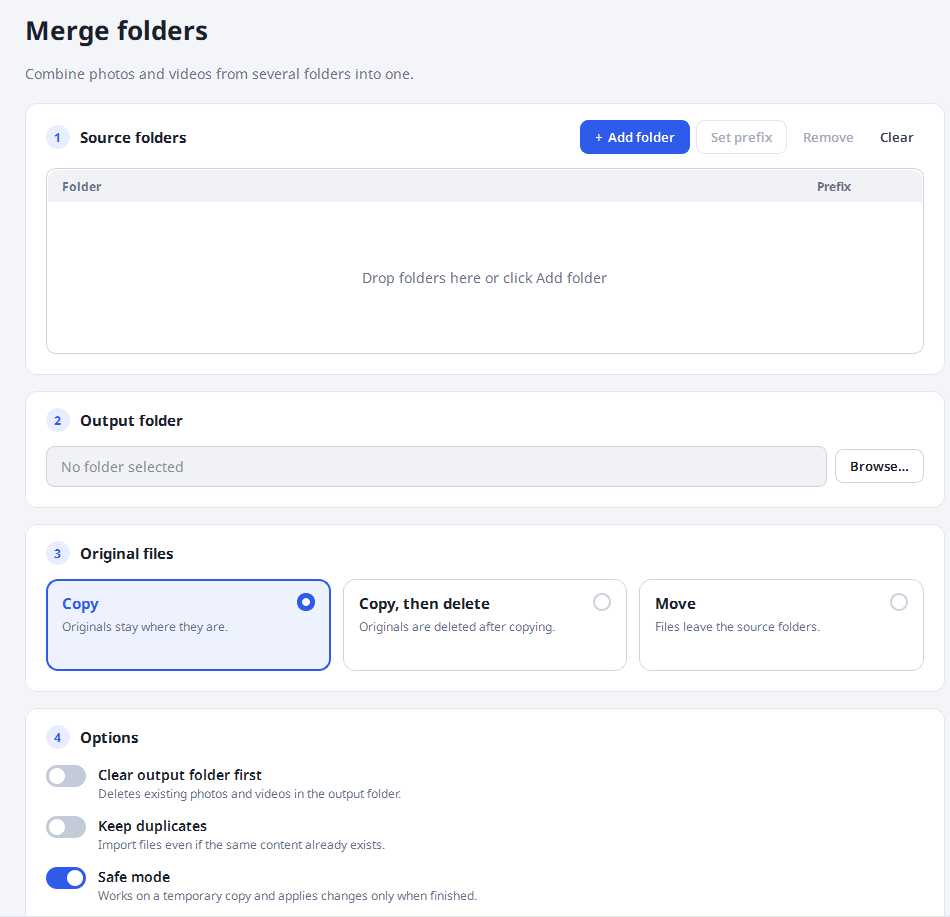
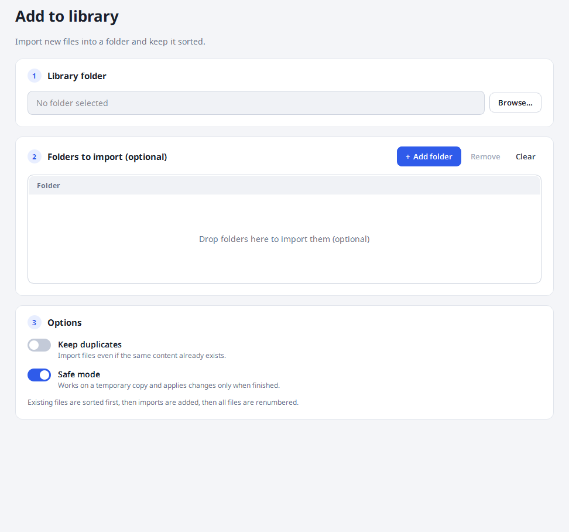
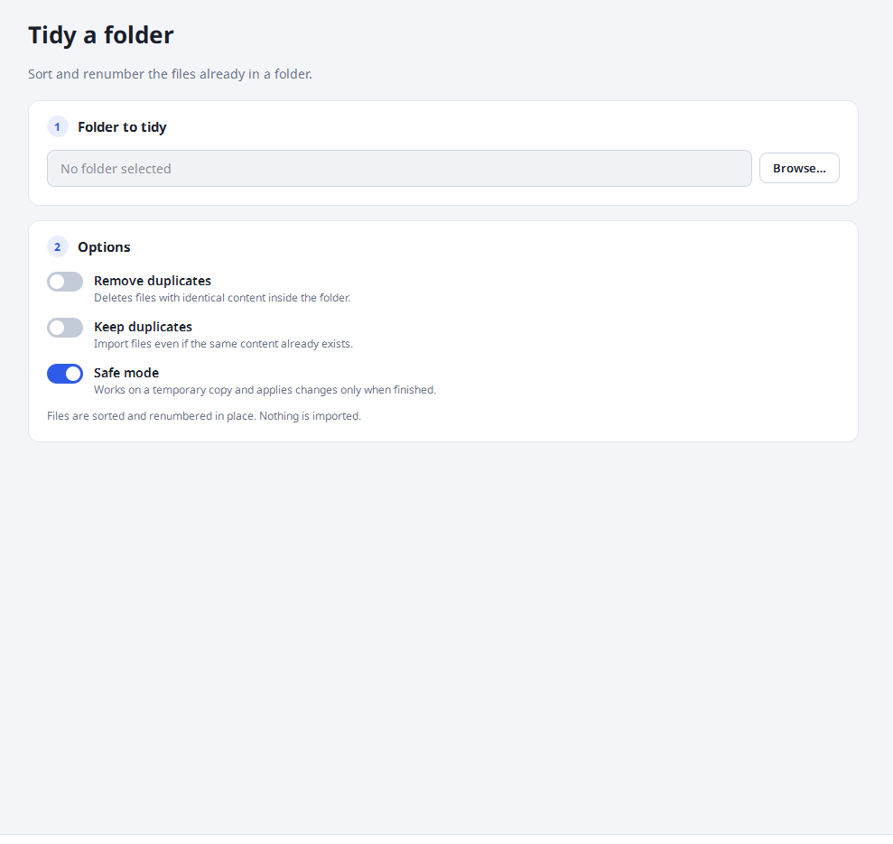

# ImageMerge

ImageMerge combines images and videos from folders, removes duplicate files,
and renames the results into an ordered sequence.

## Features

- Merge files from multiple folders, or organize files already in one folder.
- Copy, move, or copy and delete source files.
- Detect duplicates by file content and extension.
- Add an optional prefix to filenames.
- Stage changes in a temporary workspace by default; staged changes are applied
  only when processing completes.
- Sort media into predictable groups and rename them into one sequence.

## Mode Preview

<table style="width:100%; table-layout:fixed; text-align:center; margin:auto;">
  <thead>
    <tr>
      <th style="text-align:center;">Merge</th>
      <th style="text-align:center;">Library</th>
      <th style="text-align:center;">Tidy</th>
    </tr>
  </thead>
  <tbody>
    <tr>
      <td>
        
      </td>
      <td>
        
      </td>
      <td>
        
      </td>
    </tr>
  </tbody>
</table>

## Sort priority

For **Merge** (copy/move from input folders), compare top to bottom. Each
extension is sorted separately; within an extension, filename classes are
ordered as shown:

```text
1. Media type: Images → Videos
2. Extension, within each media type:
   ├─ Images: .png → .jpg → .jpeg → .webp → .bmp → .gif → .tiff
   └─ Videos: .mp4 → .mov → .mkv → .avi → .webm → .m4v → .wmv → .flv → .ts → .mts
3. Filename class, within each extension:
   ├─ IMG + number → IMG number → timestamp → filename
   ├─ UUID/hash    → timestamp → filename
   └─ Other names → parsed number → duplicate suffix → timestamp → filename
```

`IMG + number` means a filename matching the app's `IMG` pattern, e.g.
`IMG_2.jpg`; plain `2.jpg` is an **Other name**. For other names, the parser
can extract a number from names such as `2.jpg`, `2-holiday.jpg`, and
`holiday-2.jpg`; these sort numerically (`2` before `10`). A suffix such as
`(1)` after the number is the next tie-breaker. Names with no parsed number
(e.g. `holiday.jpg`, words in any language) sort after numbered names, then by
timestamp and filename. UUID/hash names must match the app's recognized UUID
or hexadecimal-hash patterns.

Numbers sort ascending; timestamps sort oldest first. Merge uses the OS
creation/change timestamp (`ctime`; its meaning varies by OS). Filename class
comes before date, so an older UUID/hash file still follows an `IMG` file of
the same extension. Input-folder order and input prefix do not affect sorting;
the prefix is only added to the output name.

After sorting, output numbering runs continuously from `0001` across extensions
and input folders.

Example input:

```text
trip/
├── 10.png
├── 2.png
└── 1.jpg
more/
├── 1.png
├── 3.jpg
└── 2.mp4
```

Result (with `trip` and `more` supplied as input prefixes):

```text
more-0001.png   # more/1.png
trip-0002.png   # trip/2.png
trip-0003.png   # trip/10.png
trip-0004.jpg   # trip/1.jpg
more-0005.jpg   # more/3.jpg
more-0006.mp4   # more/2.mp4
```

Organizers use different rules for files already in the target folder:

```text
main_folder:   media type → extension → sequence number → duplicate suffix → prefix → filename
inside_folder: media type → extension → modification time → sequence number → duplicate suffix → filename
```

Images still come before videos and extensions use the same order above. In
`main_folder`, existing output files are ordered by their sequence numbers;
newly imported files are first ordered by the Merge rules. In
`inside_folder`, modification time is oldest first.

## Download and install

Download the package for your operating system from
[GitHub Releases](https://github.com/TamKungZ/ImageMergePy/releases).

### Windows

- Install from the [Microsoft Store](https://apps.microsoft.com/detail/9ndnkpjpzt67)
  or with WinGet: `winget install TamKungZ.ImageMerge`.
- Or download and run `ImageMerge-windows-x64.msi`.
- The standalone ZIP does not install the app; extract it and run
  `ImageMerge.exe`.
- The MSI adds `ImageMerge` to `PATH`. Open a new terminal to use the CLI.

### Linux

- Ubuntu: install the `.deb` from Releases, or use the PPA on Ubuntu 22.04,
  24.04, or 26.04:

  ```bash
  sudo add-apt-repository ppa:tamkungz/stable
  sudo apt update
  sudo apt install imagemerge
  ```

- Fedora and compatible distributions: install the `.rpm`.
- AppImage, Flatpak, and Snap packages are also available in Releases.
- The `.deb`, `.rpm`, and PPA packages provide the `imagemerge` command.

### macOS

- Install with Homebrew:

  ```bash
  brew tap TamKungZ/tap
  brew install --cask imagemerge
  ```

- Or download the app bundle for Apple Silicon (`arm64`) or Intel (`x64`).
  Direct-download bundles are not signed or notarized, so Gatekeeper may block
  them.

## Command line

Packaged builds can run without opening the GUI. Repeat `--input` for each
source folder; a prefix can be added as `PATH::PREFIX`.

```bash
imagemerge --input "/path/to/photos::trip" --input "/path/to/videos" --output "/path/to/output" --mode copy_keep
```

On Windows, use `ImageMerge` instead of `imagemerge`.

Available modes:

- `copy_keep` (default): copy files and keep the originals.
- `copy_delete`: copy files, then delete the originals.
- `move`: move files to the output folder.
- `main_folder`: organize the output folder, then optionally import other
  folders. No `--input` is required.
- `inside_folder`: organize files in the output folder in place.

Input folders must already exist. `--clear-output` removes media files from the
output before processing. `--remove-duplicates` applies only to
`inside_folder`; `--allow-duplicates` imports matching files instead of
skipping them. Safe temporary staging is on by default; use `--no-safe-temp` to
write directly to the output folder.

## For developers

Run from source with Python 3.10 or later, install the dependencies in
`requirements.txt`, then launch with `python MainApp.py`. The native C ABI SDK
for calling ImageMerge from other languages is documented in
[`native/imagemerge-sdk`](native/imagemerge-sdk/README.md).

See [Releases.md](Releases.md) for version history.
